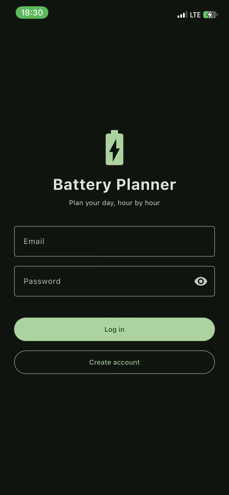
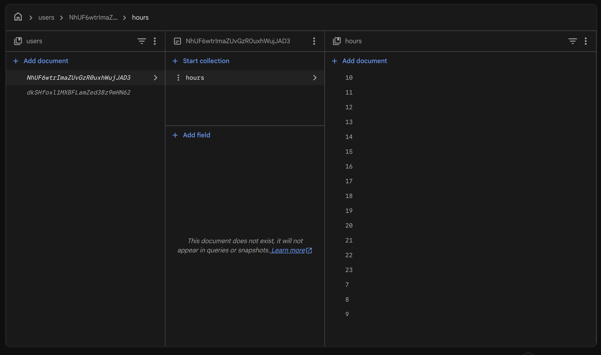
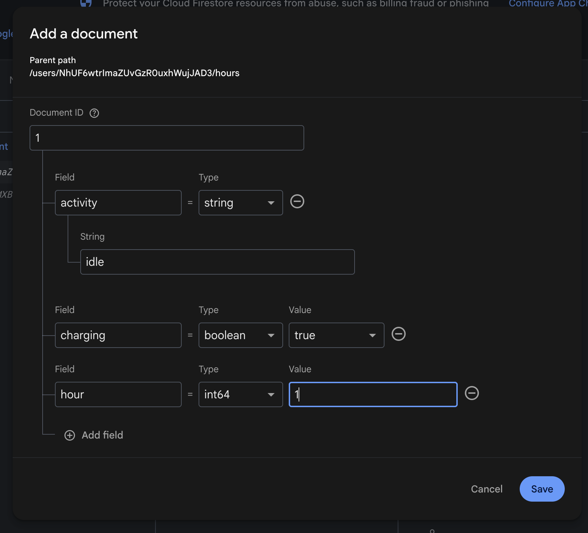
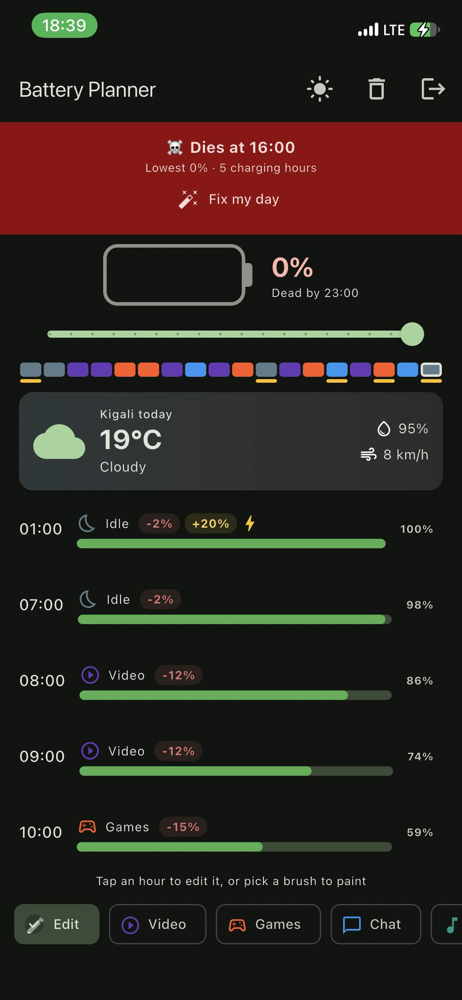
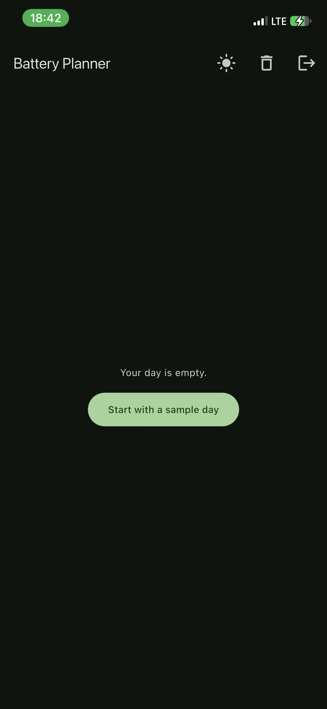

# Battery Planner

Battery Planner lets you plan your phone use hour by hour and shows whether the battery survives the day. It signs users in with Firebase Authentication, and each user's data is saved in Cloud Firestore under their own id, so two accounts never see each other's data, and every change appears live.

## What it does

- **Login:** sign up and log in with email and password (Firebase Authentication). New accounts start with a sample day.
- **Plan:** one Firestore document per hour at `users/{uid}/hours/{hour}` with the fields `hour`, `activity` and `charging`.
- **Live updates:** the plan listens with `snapshots()`, so a change in the Firestore console or on another device shows up without restarting.
- **Edit and delete:** tap an hour to edit it (or paint hours with a brush, or swipe a tile). The bin icon in the app bar deletes the whole plan.
- **Battery simulation:** the app works out the battery level for each hour, tells you when it dies, and "Fix my day" adds the charging hours needed to survive.
- **Weather:** today's weather in Kigali from the Open-Meteo API.
- **Security rules:** `firestore.rules` only lets a signed-in user read and write their own `users/{uid}` data. Test mode is not used.

## Screenshots

### Login

The login screen with the app's own name on it.

### My data in Firestore

The Firebase console open on `users` → my user id → `hours`, with one document per hour (7 to 23). The second user id in the list is the second test account.

### Live update

While the app was open on my iPhone, I added a document for hour `1` in the Firestore console (`activity` = idle, `charging` = true, `hour` = 1).

The new 01:00 hour then appeared at the top of the plan in the app, with charging on, without restarting it.

### Second account sees nothing of mine

Signed in with a second account: it sees its own data, not mine. Its day is empty.

